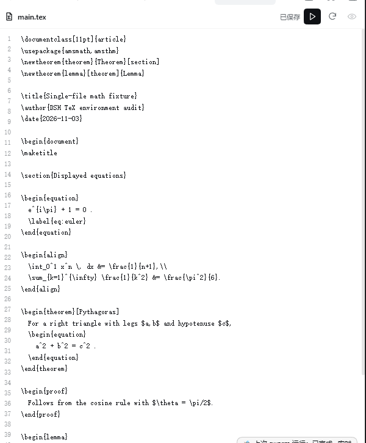
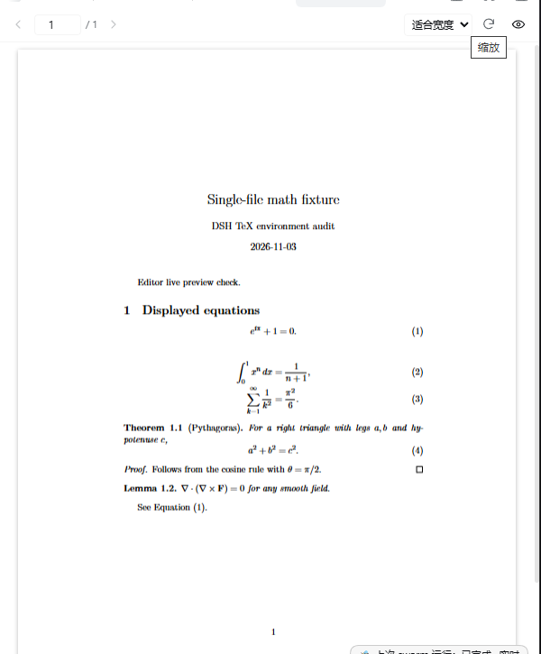

# dsh-latex

[](https://github.com/Yaohua-Leo/dsh-latex/actions/workflows/ci.yml)
[](LICENSE)
[](package.json)

A native [DeepSeek Harness](https://github.com/deepseek-ai/deepseek-harness)
(`dsh`) plugin for the full local LaTeX loop: **open a `.tex` file in the
sidebar editor → save and compile with TeX Live `latexmk` → read structured
diagnostics → watch the PDF preview refresh in place**.

It is a real DSH bundle with a Host half and a Web Client half, not a wrapper
script. Install it through DSH's plugin manager; no build step or npm
dependencies are required.




## Features

- **Edit `.tex` directly in the right sidebar.** Opening any `.tex` file address
  claims it with an extension-priority tab type, so DSH opens the plugin's
  line-numbered editor instead of the read-only document preview. Chapter files
  resolve to their real main document on save.
- **Save = compile = refresh.** The triangle button (or Ctrl+S) atomically writes
  the source and runs `latexmk`; an open PDF preview updates through DSH's SSE
  state stream. The first successful save opens a preview if none is open.
- **Structured diagnostics.** Failures show the error count and the first
  `file:line` message in the editor; `latex_get_diagnostics` and
  `latex_get_status` return the full structured result to the agent.
- **Safe writes.** Only existing `.tex` files, only inside the configured
  `allowedRoots` fence, no UNC/network paths, realpath re-validation, 4 MiB
  cap, UTF-8 validation, BOM/EOL preservation, atomic replace and a revision
  compare-and-swap (external edits produce a conflict instead of being
  overwritten).
- **PDF preview.** PDF.js viewer with page jump, fit-width and 25–200% zoom,
  lazy page rendering, stale-build banner, last-good PDF preservation, and
  double-click inverse SyncTeX (opens the editor at the corresponding line).
- **Agent tools.** Seven tools: compile, preview, diagnostics, status, clean,
  cancel, SyncTeX.
- **Project detection.** Explicit main file, `% !TEX root`, the file's own
  `\documentclass`, reverse `\input`/`\include` graph, and the session
  workspace. Multi-root projects are separate projects.
- **No shell, no default shell escape.** `latexmk` receives an argv array; a
  project `.latexmkrc` is honoured by default and `allowProjectLatexmkrc: false`
  passes `-norc`.

## Requirements

- DeepSeek Harness with the Web Client plugin system. Tested against
  **0.2.1-rc.5** on Windows 11. The POSIX code path is implemented but has not
  been end-to-end tested.
- TeX Live (or another TeX distribution) with `latexmk` and at least one of
  `xelatex`, `pdflatex`, `lualatex`; optional `biber`, `bibtex`, `synctex`.
- Node.js 20+ for the Host half (DSH ships its own Electron runtime; this is
  only about the plugin code).
- PDF.js is vendored in `assets/` (Apache-2.0); the plugin makes no network
  requests at runtime.

## Install

### From the marketplace

Once the plugin is listed in the DSH plugin catalog, search for **dsh-latex**
in **Plugins → Discover** (or the dsh-market plugin) and click Install. The
catalog entry points at the GitHub release tarball below.

### From a GitHub release (recommended today)

```sh
dsh plugin --profile desktop add \
  https://github.com/Yaohua-Leo/dsh-latex/releases/latest/download/dsh-latex.tgz
```

The release asset is a prebuilt `.tgz`, so pnpm does not need to run a build
script. Use `--profile web` for a web profile.

### From a checkout (development)

```sh
git clone https://github.com/Yaohua-Leo/dsh-latex.git
cd dsh-latex
npm test
```

Then install the absolute directory through DSH's Plugin Manager:

```text
plugin_manager action=install_bundle target=/absolute/path/to/dsh-latex
```

or from a shell:

```sh
dsh plugin --profile desktop add /absolute/path/to/dsh-latex
```

A new bundle activates through HMR; refresh the browser page once if the tab
did not appear. Host-side source edits take effect after a plugin-manager
recomposition or a DSH restart. Disable/remove with `plugin_manager
action=set_bundle target=dsh-latex enabled=false` or `action=remove_bundle`.

## Quick start

1. Open a `.tex` file from the right-sidebar file tree (or double-click a PDF to
   jump to its source line). The **TeX editor** tab opens directly.
2. Edit the source and click the **triangle save button** or press **Ctrl+S**.
3. The Host resolves the main document, runs `latexmk`, and publishes the PDF.
   The **PDF 预览** tab shows the new build, or opens automatically on the first
   successful save.
4. If the build fails, the editor shows the error count and the first
   `file:line` message; ask the agent to call `latex_get_diagnostics` for the
   full list, fix the source and save again.

Example requests to the agent:

- “修改这个定理的证明，然后重新编译并打开 PDF。”
- “编译 `main.tex`，检查所有 LaTeX 错误并修复，直到能成功生成 PDF。”
- “从 `sections/intro.tex` 第 12 行定位到 PDF 第几页。”
- “清理这个项目的辅助文件，保留 PDF。”

## Configuration

Defaults live in `cordis.patch.yml`; override any field from the profile patch
layer, for example:

```yaml
- override:
    - id: latex
      config:
        engine: lualatex
        timeoutMs: 300000
        texBinDir: 'C:\texlive\2024\bin\windows'
```

| Key | Default | Meaning |
| --- | --- | --- |
| `texBinDir` | `''` | Directory containing `latexmk` and the engines. Empty discovers `latexmk` from `DSH_LATEX_TEX_BIN` or `PATH`; set it when TeX Live is not on `PATH`. |
| `latexmkPath` | `''` | Explicit `latexmk` executable; empty means `<texBinDir>/latexmk` or PATH discovery. |
| `engine` | `xelatex` | `xelatex`, `pdflatex` or `lualatex`; a `% !TEX program` directive can override it. |
| `buildDir` | `build` | Output/aux directory relative to the main `.tex` directory. |
| `autoBuild` | `true` | Watch project sources and rebuild after saves (debounced and coalesced). |
| `debounceMs` | `800` | Quiet window before an automatic build. |
| `timeoutMs` | `180000` | Hard build timeout; the latexmk/perl/engine process tree is terminated. |
| `preserveLastGood` | `true` | Publish only successful PDFs; a failed build keeps the previous preview. |
| `autoOpenPreview` | `true` | Open/focus the preview after an explicit successful build. |
| `previewSurface` | `native` | `native` = plugin PDF.js tab; `document` = DSH built-in document preview. |
| `allowedRoots` | `[]` | Optional entry allowlist for project main files. Empty allows any local project. This is an accidental-operation fence, not a sandbox. |
| `extraLatexmkArgs` | `[]` | Extra argv elements appended to latexmk (never shell-interpreted). |
| `maxConcurrentBuilds` | `2` | Global process cap (1–8). |
| `respectLatexmkrc` | `true` | With a project `.latexmkrc`, do not force the configured engine flag. |
| `allowProjectLatexmkrc` | `true` | Honour project/user rc files. Set `false` to pass `-norc`. |
| `allowShellEscape` | `false` | When false, pass `-no-shell-escape`; `\write18` must be explicitly enabled. |
| `maxPrintLine` | `2000` | `max_print_line` for the TeX child; reduces wrapped log lines. |

`DSH_LATEX_TEX_BIN` is an environment-variable fallback for `texBinDir`; an
explicit `texBinDir` wins. `texBinDir` is prepended to the child `PATH`, so a
TeX Live installation does not have to be on the Host's system `PATH`.

## Tools

| Tool | Purpose |
| --- | --- |
| `latex_compile` | Build the detected project (`latexmk`; engine override, force, timeout, open preview). `path` may be a `.tex` file or a project directory. |
| `latex_preview` | Open/focus the in-app preview (`page`, `surface: native|document`; compiles first when needed). |
| `latex_get_diagnostics` | Structured errors/warnings with `file:line` from the last build. |
| `latex_get_status` | Main file, engine, build/preview state, stale flag, toolchain, auto-build/watcher state. |
| `latex_clean` | Remove recognized auxiliary files only; refuses while a build is running. |
| `latex_cancel` | Terminate the latexmk process tree; also works while queued. |
| `latex_synctex` | Forward (source → PDF page/x/y) and inverse (PDF → source file/line), including CJK and space paths. |

Root-document resolution order: explicit main file → `% !TEX root = ...` → the
file's own `\documentclass` → reverse `\input`/`\include` graph (preferring
`main.tex`, `paper.tex`, …) → a single root document under the session cwd.
Multiple root documents in one directory are separate projects with separate
published previews.

## How it works

- **Host** (`index.js`, `src/*.js`): project resolver, project registry, build
  queue with a global semaphore, recursive source watcher with debounce and
  auto-build coalescing, `latexmk` argv construction, log/BibTeX/Biber parsing,
  last-good PDF publication, SyncTeX, seven tools and the loopback HTTP/SSE
  surface.
- **Client** (`client.js`): a `.tex`-claiming resource tab (line-numbered
  textarea editor with save/compile/reload/preview controls), a PDF.js preview
  tab, and compact tool-result cards. No external JS dependencies; React is
  provided by DSH's module table.
- **State**: build queue and diagnostics are kept in the Host process; the last
  successful preview version is persisted in
  `<buildDir>/.dsh-latex/last-build-<fingerprint>.json` and restored after a
  restart. Full build history is not persisted.
- **HTTP surface** (same-origin, loopback): `GET /latex/health`, `/state`,
  `/events` (SSE), `/file?path=`, `/pdf?project=`, `/log?project=`,
  `/assets/*`, `POST /file`, `POST /action` (including `compile-file`),
  `GET /synctex`, `POST /synctex-inverse`. Everything except `health` uses the
  Harness connection admission; the PDF route serves only a registered
  project's published preview. `POST /file` is not a general filesystem API.

## Security

TeX compilation is **not a sandbox**: a project can execute code through
`.latexmkrc` and TeX's file primitives, and the editor write API runs with Host
permissions. The full threat model and reporting process are in
[SECURITY.md](SECURITY.md). In short:

- no shell interpolation; argv arrays only;
- `-no-shell-escape` by default;
- project `.latexmkrc` is executable Perl and is honoured by default —
  set `allowProjectLatexmkrc: false` for untrusted projects;
- `allowedRoots` is an entry fence, not a filesystem boundary;
- build untrusted documents in a low-privilege container/VM.

## Limitations

- The editor is a plain `<textarea>` plus line numbers: no syntax highlighting,
  autocomplete, multi-cursor or automatic save. Ctrl+S / the triangle button is
  the only compile trigger.
- Closing an editor tab discards unsaved text; switching tabs does not
  (`keepMounted`).
- Only UTF-8 `.tex` files up to 4 MiB can be edited; new files and directories
  cannot be created from the editor.
- Build history and diagnostics live in Host memory; a restart restores the
  last successful preview version but not historical diagnostics.
- PDF preview state (page/zoom) is kept per project for the session; the
  preview tab itself is one per session.
- The browser half is tested on DSH 0.2.1-rc.5/Windows 11; other platforms and
  older/newer DSH releases should be treated as untested.
- `.latexmkrc` and TeX file I/O are documented security boundaries, not bugs.

More detail: [docs/limitations.md](docs/limitations.md).

## Development

```sh
npm test          # node:test, no dependencies
npm run check     # node --check index.js client.js src/*.js
npm pack --dry-run
```

Examples that exercise the editor and PDF preview are in
[`examples/`](examples/): `hello/`, `chinese/` (ctex + XeLaTeX) and
`multi-file/` (`\input` + cross-reference). Build output is ignored by Git.

The repository also carries the original engineering records:
[docs/architecture.md](docs/architecture.md),
[docs/acceptance.md](docs/acceptance.md),
[docs/api-cheatsheet.md](docs/api-cheatsheet.md),
[docs/limitations.md](docs/limitations.md),
[docs/security-audit.md](docs/security-audit.md),
[docs/synctex-notes.md](docs/synctex-notes.md), and the review notes under
`docs/`. They contain absolute paths and commands from the development machine;
they are notes, not installation instructions.

CI runs the syntax check, unit tests and `npm pack --dry-run` on Ubuntu and
Windows with Node 22.

## License

MIT. PDF.js (`assets/pdf.min.mjs`, `assets/pdf.worker.min.mjs`) is
Copyright 2024 Mozilla Foundation, Apache-2.0; see
[`assets/licenses/PDFJS-NOTICE.txt`](assets/licenses/PDFJS-NOTICE.txt) and the
license headers retained in the files. The plugin performs no downloads at
runtime.
