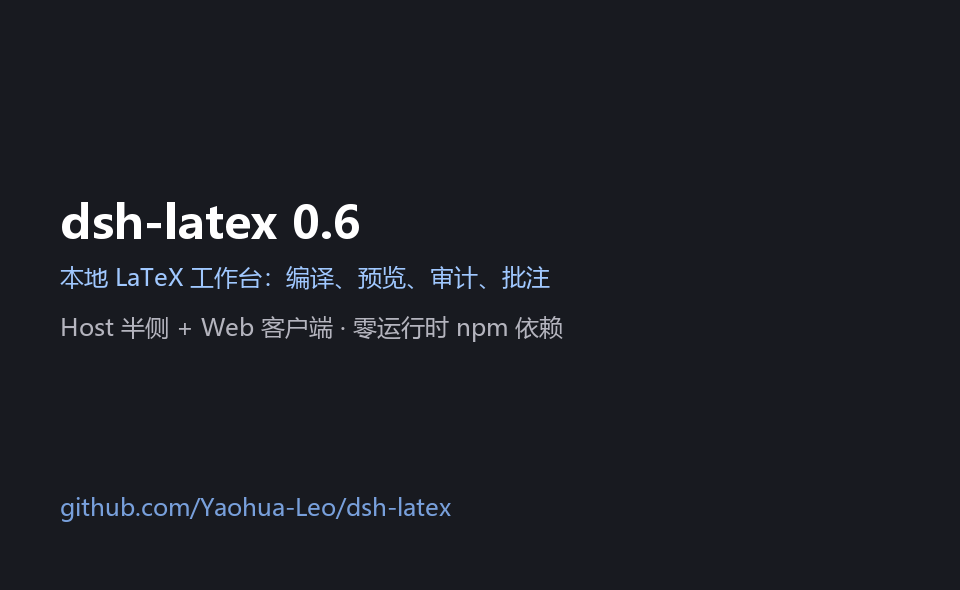
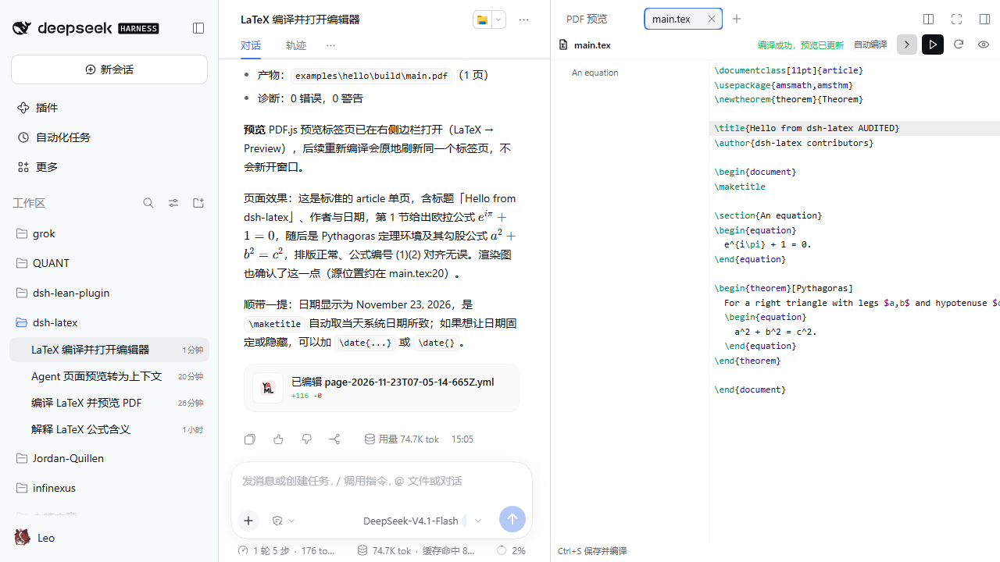
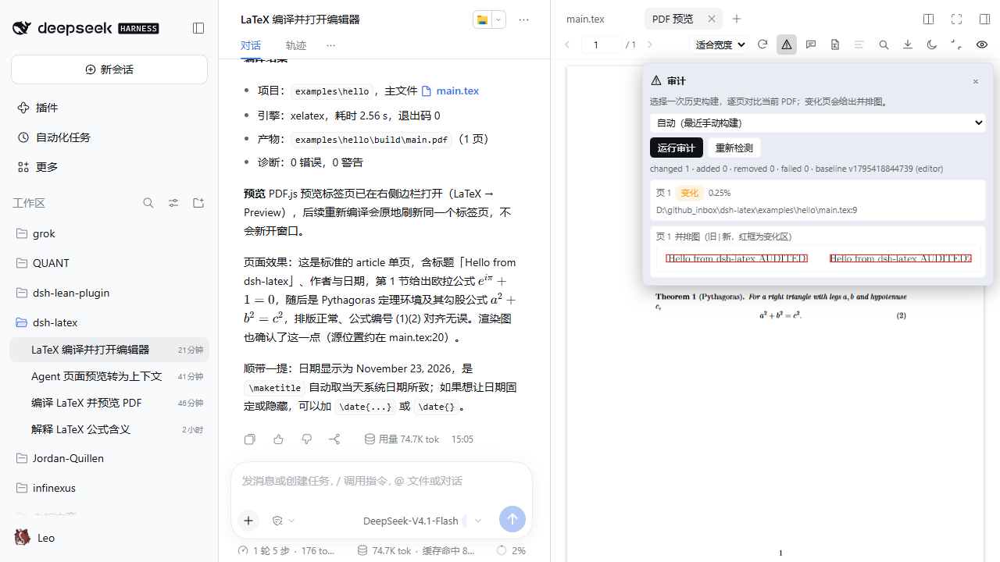

# dsh-latex

[](https://github.com/Yaohua-Leo/dsh-latex/actions/workflows/ci.yml)
[](LICENSE)
[](package.json)

A native [DeepSeek Harness](https://github.com/deepseek-ai/deepseek-harness)
(`dsh`) plugin for the full local LaTeX loop: **open a `.tex` file in the
sidebar editor → save and compile with TeX Live `latexmk` → read structured
diagnostics → watch the PDF preview refresh in place**.

It is a real DSH bundle with a Host half and a Web Client half, not a wrapper
script. Install it through DSH's plugin manager; there are no runtime npm
dependencies (PDF.js and CodeMirror are vendored).






## Features

- **Edit `.tex` directly in the right sidebar.** Opening any `.tex` file address
  claims it with an extension-priority tab type, so DSH opens the plugin's
  line-numbered editor instead of the read-only document preview. Chapter files
  resolve to their real main document on save.
- **Save = compile = refresh.** The triangle button (or Ctrl+S) runs immediately;
  by default the editor also **auto-saves and compiles after you stop typing**
  (900 ms debounce, configurable). An open PDF preview updates through DSH's
  SSE state stream; the first successful save opens one if none is open.
- **Structured diagnostics.** Failures show the error count and the first
  `file:line` message in the editor; `latex_get_diagnostics` and
  `latex_get_status` return the full structured result to the agent.
- **Safe writes.** Only existing `.tex` files, only inside the configured
  `allowedRoots` fence, no UNC/network paths, realpath re-validation, 4 MiB
  cap, UTF-8 validation, BOM/EOL preservation, atomic replace and a revision
  compare-and-swap (external edits produce a conflict instead of being
  overwritten).
- **PDF preview.** PDF.js viewer with page jump, fit-width and 25–200% zoom,
  lazy page rendering, stale-build banner, last-good PDF preservation, and
  `Ctrl`/`Cmd` + click inverse SyncTeX (opens the editor at the corresponding line).
- **SyncTeX both ways.** `Ctrl`/`Cmd` + click a line in the editor to jump the
  preview to that page and spot (forward SyncTeX, with a short highlight ring
  on the target), and `Ctrl`/`Cmd` + click a page to jump back to the source line.
  A plain double-click keeps selecting words for ask/annotate.
- **Agent page vision.** `latex_look` renders one compiled page to a PNG and
  returns it to the model as an image, resolves a text/point anchor to
  `file:line` through SyncTeX, and diffs the page against the previous build.
  Renders are cached by PDF content hash; Poppler's `pdftoppm`/`pdftotext` ship
  with TeX Live, so no npm dependency is added.
- **PDF as context.** Preview pages are selectable: send the quote to the
  current chat (or copy it when the Host has no session controller) or save it
  as an annotation. A toolbar **marquee** captures a page region as a PNG and
  sends it to the model, so scanned PDFs without a text layer remain usable;
  screenshots can also be saved as annotations, optionally with local OCR text.
  `latex_annotations` lists/resolves/deletes them, and after a rebuild they are
  re-anchored by their quote or marked stale.
- **Local OCR model (no API key).** When the screenshot popover has no OCR
  engine, it offers **一键安装本地 OCR**: RapidOCR (PP-OCRv4 ONNX) is installed
  into a managed Python venv (about 150 MB, models included), with progress and
  cancel. Tesseract remains an automatic fallback if already installed.
- **Whole-document audit.** `latex_audit` compares the current build with a
  retained previous build (or the last manual build / a version from the build
  history) page by page and returns cropped side-by-side images (old | new, red
  diff box) for changed pages, bounded by page/dpi/image budgets. The preview
  **Audit** panel runs it without the model, streams page progress, and shows
  the composites; auto-builds are never the default baseline.
- **Paper checks.** Four read-only tools cover the “compiles but is not
  submittable” class: citation audit (missing/never cited), bib lint (duplicate
  keys, required fields), a dry-run Crossref fill for one DOI (no API key), and
  layout lint (overfull boxes, undefined refs, page/figure/table counts,
  configurable regex rules).
- **Editor.** Vendored CodeMirror 6: LaTeX highlighting, line numbers, search,
  outline jump, `Ctrl+S` compile, draft recovery per tab, and a disk-change
  banner. Falls back to the original textarea if the chunk fails to load.
- **Preview UX.** PDF outline, per-project page/zoom persistence, in-document
  search (`Ctrl+F`), download, dark preview, marquee screenshots and annotations.
- **Optional TeX bootstrap.** On Windows, a one-click TinyTeX install downloads
  the official self-extracting asset, verifies SHA-256 when configured,
  extracts into the user directory, and switches `texBinDir` without touching
  PATH or the registry; progress and cancel are visible in the UI.
- **Agent tools.** Fourteen tools: compile, preview, diagnostics, status, clean,
  cancel, SyncTeX, look, audit, annotations, citation audit, bib lint, layout
  lint, Crossref fill.
- **Project detection.** Explicit main file, `% !TEX root`, the file's own
  `\documentclass`, reverse `\input`/`\include` graph, and the session
  workspace. Multi-root projects are separate projects.
- **No shell, no default shell escape.** `latexmk` receives an argv array; a
  project `.latexmkrc` is honoured by default and `allowProjectLatexmkrc: false`
  passes `-norc`.

## Requirements

- DeepSeek Harness with the Web Client plugin system. Verified against
  **0.2.1-rc.5** on Windows 11; Ubuntu is covered by the real-TeX e2e CI, and
  macOS gets unit CI plus a best-effort BasicTeX e2e job. See
  [`docs/platform-support.md`](docs/platform-support.md).
- TeX Live (or another TeX distribution) with `latexmk` and at least one of
  `xelatex`, `pdflatex`, `lualatex`; optional `biber`, `bibtex`, `synctex`.
  `latex_look` additionally needs a PDF renderer: `pdftoppm`/`pdftotext` are
  included by TeX Live (verified with Poppler 25.02); Ghostscript or muPDF are
  fallbacks for distributions that drop the Poppler tools.
- Optional: Python 3 for the one-click **RapidOCR** local OCR install (the UI
  creates an isolated venv; models are included in the wheel). Tesseract is
  also detected as a fallback. Without either engine, screenshots still work
  and simply carry no OCR text.
- Node.js 20+ for the Host half (DSH ships its own Electron runtime; this is
  only about the plugin code).
- PDF.js and the CodeMirror bundle are vendored in `assets/` (Apache-2.0 and
  MIT; notices included). The plugin makes no network requests at runtime
  except an explicit `latex_bib_fill` Crossref lookup and the optional TinyTeX
  download.

## Install

### From the marketplace

Once the plugin is listed in the DSH plugin catalog, search for **dsh-latex**
in **Plugins → Discover** (or the dsh-market plugin) and click Install. The
catalog entry points at the GitHub release tarball below.

### From npm (recommended today)

```sh
dsh plugin --profile desktop add @yaohualiu/dsh-latex
```

The package is published as `@yaohualiu/dsh-latex`; no build script or runtime
npm dependencies are involved. Use `--profile web` for a web profile.

### From a GitHub release

```sh
dsh plugin --profile desktop add \
  https://github.com/Yaohua-Leo/dsh-latex/releases/latest/download/dsh-latex.tgz
```

The release asset is a prebuilt `.tgz`, so pnpm does not need to run a build
script. The package inside is the same scoped `@yaohualiu/dsh-latex`.

### From a checkout (development)

```sh
git clone https://github.com/Yaohua-Leo/dsh-latex.git
cd dsh-latex
npm test
```

Then install the absolute directory through DSH's Plugin Manager:

```text
plugin_manager action=install_bundle target=/absolute/path/to/dsh-latex
```

or from a shell:

```sh
dsh plugin --profile desktop add /absolute/path/to/dsh-latex
```

A new bundle activates through HMR; refresh the browser page once if the tab
did not appear. Host-side source edits take effect after a plugin-manager
recomposition or a DSH restart. Disable/remove with `plugin_manager
action=set_bundle target=@yaohualiu/dsh-latex enabled=false` or `action=remove_bundle`.

## Quick start

1. Open a `.tex` file from the right-sidebar file tree (or `Ctrl`+click a spot in
   the PDF to jump to its source line). The **TeX editor** tab opens directly.
2. Edit the source. After you pause for about a second the editor **auto-saves
   and compiles**; the triangle button / **Ctrl+S** is still available when you
   want an immediate build.
3. The Host resolves the main document, runs `latexmk`, and publishes the PDF.
   The **PDF 预览** tab shows the new build, or opens automatically on the first
   successful save.
4. If the build fails, the editor shows the error count and the first
   `file:line` message; ask the agent to call `latex_get_diagnostics` for the
   full list, fix the source and save again.

Example requests to the agent:

- “修改这个定理的证明，然后重新编译并打开 PDF。”
- “编译 `main.tex`，检查所有 LaTeX 错误并修复，直到能成功生成 PDF。”
- “从 `sections/intro.tex` 第 12 行定位到 PDF 第几页。”
- “清理这个项目的辅助文件，保留 PDF。”

## Configuration

Defaults live in `cordis.patch.yml`; override any field from the profile patch
layer, for example:

```yaml
- override:
    - id: latex
      config:
        engine: lualatex
        timeoutMs: 300000
        texBinDir: 'C:\texlive\2024\bin\windows'
```

| Key | Default | Meaning |
| --- | --- | --- |
| `texBinDir` | `''` | Directory containing `latexmk` and the engines. Empty discovers `latexmk` from `DSH_LATEX_TEX_BIN` or `PATH`; set it when TeX Live is not on `PATH`. |
| `latexmkPath` | `''` | Explicit `latexmk` executable; empty means `<texBinDir>/latexmk` or PATH discovery. |
| `engine` | `xelatex` | `xelatex`, `pdflatex` or `lualatex`; a `% !TEX program` directive can override it. |
| `buildDir` | `build` | Output/aux directory relative to the main `.tex` directory. |
| `autoBuild` | `true` | Watch project sources and rebuild after saves (debounced and coalesced). |
| `debounceMs` | `800` | Quiet window before an automatic build. |
| `timeoutMs` | `180000` | Hard build timeout; the latexmk/perl/engine process tree is terminated. |
| `preserveLastGood` | `true` | Publish only successful PDFs; a failed build keeps the previous preview. |
| `autoOpenPreview` | `true` | Open/focus the preview after an explicit successful build. |
| `previewSurface` | `native` | `native` = plugin PDF.js tab; `document` = DSH built-in document preview. |
| `allowedRoots` | `[]` | Optional entry allowlist for project main files. Empty allows any local project. This is an accidental-operation fence, not a sandbox. |
| `extraLatexmkArgs` | `[]` | Extra argv elements appended to latexmk (never shell-interpreted). |
| `maxConcurrentBuilds` | `2` | Global process cap (1–8). |
| `respectLatexmkrc` | `true` | With a project `.latexmkrc`, do not force the configured engine flag. |
| `allowProjectLatexmkrc` | `true` | Honour project/user rc files. Set `false` to pass `-norc`. |
| `allowShellEscape` | `false` | When false, pass `-no-shell-escape`; `\write18` must be explicitly enabled. |
| `editorAutoSave` | `true` | Save and compile automatically after typing stops. Disable to require the triangle button / Ctrl+S. |
| `editorAutoSaveDelayMs` | `900` | Quiet window for auto-save in milliseconds (300–10000). |
| `maxPrintLine` | `2000` | `max_print_line` for the TeX child; reduces wrapped log lines. |
| `renderDpi` | `120` | Default render resolution for `latex_look` (36–300). |
| `renderEngine` | `auto` | `auto`, `pdftoppm`, `ghostscript` or `mutool`; `auto` picks the first available. |
| `renderTimeoutMs` | `30000` | Hard timeout for one page render. |
| `lookMaxPixels` | `4000000` | Skip the pixel diff above this image size. |
| `lookCacheKeep` | `2` | Build hashes of rendered pages to keep (2 preserves “diff vs previous build”). |
| `annotationsMaxItems` | `200` | Maximum annotations per project. |
| `annotationsMaxBytes` | `262144` | Maximum on-disk JSON size for one project’s annotations. |
| `annotationImageMaxBytes` | `5242880` | Maximum PNG/JPEG/WebP bytes for one screenshot annotation. |
| `annotationsLockWaitMs` | `5000` | How long a writer waits for the cross-process annotation lock. |
| `annotationsLockStaleMs` | `15000` | A lock older than this is treated as crashed and reclaimed. |
| `auditMaxPages` | `30` | Default page budget for `latex_audit`. |
| `auditDpi` | `100` | Default render resolution for audit comparisons. |
| `auditMaxImages` | `3` | Maximum side-by-side composites returned per audit. |
| `askImageMaxBytes` | `8388608` | Maximum screenshot size accepted by `/latex/ask-image`. |
| `ocrEnabled` | `auto` | `auto`, `always` or `off`; global OCR switch. |
| `ocrEngine` | `auto` | `auto` (RapidOCR, then Tesseract), `rapidocr`, `tesseract`, `off`. |
| `ocrPython` | `''` | Python 3 interpreter used to create the managed venv; empty auto-detects. |
| `ocrInstallDir` | `''` | Managed RapidOCR venv directory; empty uses `~/.dsh-latex/ocr`. |
| `ocrInstallTimeoutMs` | `900000` | Timeout for the venv/pip/model warmup install. |
| `ocrLanguages` | `eng` | Tesseract fallback language string, e.g. `eng+chi_sim` (RapidOCR is multilingual). |
| `ocrTimeoutMs` | `20000` | Hard timeout for one OCR run. |
| `layoutRules` | `[]` | Optional `{pattern,message,severity,target}` rules for `latex_layout_lint` (max 20). |
| `toolchainDir` | `''` | TinyTeX install root; empty uses `~/.dsh-latex/toolchain`. |
| `toolchainUrl` | `''` | Override the official TinyTeX asset URL (Windows one-click). |
| `toolchainSha256` | `''` | Optional expected archive SHA-256; mismatch aborts before extraction. |
| `toolchainTimeoutMs` | `600000` | Download/install timeout. |

`DSH_LATEX_TEX_BIN` is an environment-variable fallback for `texBinDir`; an
explicit `texBinDir` wins. `texBinDir` is prepended to the child `PATH`, so a
TeX Live installation does not have to be on the Host's system `PATH`.

## Tools

| Tool | Purpose |
| --- | --- |
| `latex_compile` | Build the detected project (`latexmk`; engine override, force, timeout, open preview). `path` may be a `.tex` file or a project directory. |
| `latex_preview` | Open/focus the in-app preview (`page`, `surface: native|document`; compiles first when needed). |
| `latex_get_diagnostics` | Structured errors/warnings with `file:line` from the last build. |
| `latex_get_status` | Main file, engine, build/preview state, stale flag, toolchain, auto-build/watcher state. |
| `latex_clean` | Remove recognized auxiliary files only; refuses while a build is running. |
| `latex_cancel` | Terminate the latexmk process tree; also works while queued. |
| `latex_synctex` | Forward (source → PDF page/x/y) and inverse (PDF → source file/line), including CJK and space paths. |
| `latex_look` | Render one PDF page as an image for the model (`page`, `text`, `point`, `crop`, `dpi`, `compare`); returns the SyncTeX source location and the pixel diff against the previous build. |
| `latex_audit` | Compare the whole document with the retained previous build, return changed/added/removed pages and cropped side-by-side images (`from`, `to`, `maxPages`, `dpi`, `maxImages`). |
| `latex_annotations` | List, resolve, remove or clear annotations (including screenshot/OCR items). |
| `latex_cite_audit` | Citation keys across `.tex` files vs `.bib`: cited-but-missing and never-cited, with source lines. |
| `latex_bib_lint` | Duplicate keys, missing required fields per entry type, parse errors; read-only. |
| `latex_layout_lint` | Overfull/underfull boxes, undefined refs/citations, page/figure/table counts, custom regex rules. |
| `latex_bib_fill` | Dry-run Crossref lookup for one DOI (no API key); shows only fields missing from the matching entry. |

Root-document resolution order: explicit main file → `% !TEX root = ...` → the
file's own `\documentclass` → reverse `\input`/`\include` graph (preferring
`main.tex`, `paper.tex`, …) → a single root document under the session cwd.
Multiple root documents in one directory are separate projects with separate
published previews.

## How it works

- **Host** (`index.js`, `src/*.js`): project resolver, project registry, build
  queue with a global semaphore, recursive source watcher with debounce and
  auto-build coalescing, `latexmk` argv construction, log/BibTeX/Biber parsing,
  last-good PDF publication, SyncTeX, fourteen tools, page rendering/diffing,
  annotation storage, build history, paper checks, the TinyTeX installer, and the loopback HTTP/SSE surface.
- **Rendering** (`src/render.js`, `src/png.js`): probes `pdftoppm`/`pdftotext`/
  `pdfinfo` (then Ghostscript/muPDF), anchors a quote to a page and PDF-point
  box, renders one page to a temp file and atomically renames it, diffs 8-bit
  PNGs, and encodes/crops/side-by-side-composes audit images without an image
  library.
- **Annotations** (`src/annotations.js`): per-project JSON with atomic writes,
  item/size caps, an `O_EXCL` cross-process lock, quote-based re-anchoring, and
  screenshot files under `stateDir/annotation-images/`.
- **OCR** (`src/rapidocr.js`, `src/ocr.js`): RapidOCR (PP-OCRv4 ONNX) installed
  into a managed Python venv on demand, with a bounded runner JSON protocol;
  Tesseract is the automatic fallback. Missing OCR is a skip, never a build
  failure.
- **Audit** (`src/service.js`): renders the current and retained previous PDF
  page by page, diffs them, and returns a bounded set of cropped composites.
- **Client** (`client.js`): a `.tex`-claiming resource tab (line-numbered
  CodeMirror editor with save/compile/reload/preview controls), a PDF.js preview
  tab, and compact tool-result cards. No runtime npm dependencies; React is
  provided by DSH's module table, and PDF.js/CodeMirror are vendored bundles.
- **State**: build queue and diagnostics are kept in the Host process; the last
  successful preview version and up to five history entries are persisted under
  `<buildDir>/.dsh-latex/` and restored after a restart.
- **HTTP surface** (same-origin, loopback): `GET /latex/health`, `/state`,
  `/events` (SSE), `/file?path=`, `/pdf?project=`, `/log?project=`,
  `/assets/*`, `POST /file`, `POST /action` (including `compile-file`),
  `GET /synctex`, `POST /synctex-inverse`, `POST /ask` (send a PDF selection
  into a session), `POST /ask-image` (send a cropped screenshot),
  `GET /annotation-image`, and `GET/POST/PATCH/DELETE /annotations` (DELETE also
  accepts `?id=`). Everything except `health` uses the Harness connection
  admission; the PDF route serves only a registered project's published preview.
  `POST /file` is not a general filesystem API.

## Capabilities

| Capability | Exact bounds |
| --- | --- |
| **Commands** | Spawns `latexmk`, `pdftoppm`, `pdftotext`, `pdfinfo`, optional `gswin64c`/`gs`/`mutool`, optional `tesseract` with explicit argv arrays. No shell, no remote installs. |
| **Files** | Reads `.tex`/`.bib` and the project build directory; writes `.tex` files through the revision-checked API and plugin state under `build/.dsh-latex/`. No arbitrary path writes. |
| **Network** | None by default. `latex_bib_fill` (when enabled and invoked) calls Crossref only; the explicit one-click OCR install downloads PyPI wheels. OCR inference stays local. |
| **Credentials** | None. The plugin never reads API keys or tokens; the model and its credentials belong to the Host. |
| **Lifecycle** | No `preinstall`/`install`/`postinstall` scripts. A one-click TinyTeX install, when used, is an explicit user action with progress and cancel. |

## Security

TeX compilation is **not a sandbox**: a project can execute code through
`.latexmkrc` and TeX's file primitives, and the editor write API runs with Host
permissions. The full threat model and reporting process are in
[SECURITY.md](SECURITY.md). In short:

- no shell interpolation; argv arrays only;
- `-no-shell-escape` by default;
- project `.latexmkrc` is executable Perl and is honoured by default —
  set `allowProjectLatexmkrc: false` for untrusted projects;
- `allowedRoots` is an entry fence, not a filesystem boundary;
- `latex_look` runs only local Poppler/Ghostscript/muPDF binaries with argv
  arrays, reads only the project's published PDF, and writes renders under the
  project build directory; annotations are bounded JSON written atomically;
- new preview routes (`/latex/ask`, `/latex/ask-image`,
  `/latex/annotation-image`, `/latex/annotations`) use the same connection
  admission as every other route; screenshot payloads are signature- and
  size-validated, and stored screenshots are served only from the project state
  directory;
- the annotation lock is an advisory file lock (`O_EXCL` + stale reclaim), not
  a security boundary;
- OCR executes only the managed RapidOCR Python runner or a local `tesseract`
  binary with argv arrays (no shell); the install downloads PyPI wheels;
- build untrusted documents in a low-privilege container/VM.

## Limitations

- The editor is CodeMirror 6 with LaTeX highlighting, line numbers, search and
  a section outline, but no autocomplete, multi-cursor or language server. If
  the vendored chunk cannot load it falls back to the original textarea.
  Auto-save is debounced and can be disabled with `editorAutoSave: false`; the
  triangle button and Ctrl+S always build immediately.
- Drafts are saved in `sessionStorage` per tab and restored after closing and
  reopening the tab. They do not survive a browser restart or another tab.
- Only UTF-8 `.tex` files up to 4 MiB can be edited; new files and directories
  cannot be created from the editor.
- The last five successful build previews and their metadata are persisted
  under `build/.dsh-latex/history/`; build diagnostics themselves remain in
  Host memory.
- PDF preview state (page/zoom) is persisted per project in `localStorage`; the
  preview tab itself is one per session.
- `latex_look` needs a PDF renderer (`pdftoppm` ships with TeX Live, otherwise
  Ghostscript or muPDF); without one the tool reports `NO_RENDERER` instead of
  failing silently. Text anchoring depends on `pdftotext`.
- The preview text layer is built from PDF.js text items, so a scanned PDF
  without a text layer is still view-only (no selection-based ask/annotation).
- `latex_look` renders one page per call; `latex_audit` is bounded by
  `auditMaxPages`/`auditMaxImages`, compares against one selected build
  (previous, last manual, or a history version), and returns cropped /
  padded composites rather than a video or a multi-build timeline.
- One retained `previous-<fingerprint>.pdf` plus up to five history PDFs are
  kept for audit; `latex_clean includePreview` removes them.
- Screenshot questions/annotations depend on the browser canvas crop; a scanned
  page is readable to the model but not selectable as text. OCR is optional:
  RapidOCR is installed into a managed venv on demand (Python 3 required) and
  the Tesseract fallback is only as good as its language data.
- Annotations are capped (`annotationsMaxItems` / `annotationsMaxBytes`) and
  re-anchored by exact quote text; a heavily edited sentence can become `stale`
  instead of moving silently. Image-only annotations keep a best-effort page
  rectangle after a rebuild.
- Windows 11 is the verified UI path; Ubuntu is covered by the real-TeX e2e CI,
  and macOS has unit CI plus a best-effort BasicTeX job. See
  [`docs/platform-support.md`](docs/platform-support.md).
- `.latexmkrc` and TeX file I/O are documented security boundaries, not bugs.

More detail: [docs/limitations.md](docs/limitations.md).

## Development

```sh
npm test          # node:test, no dependencies
npm run check     # node --check index.js client.js src/*.js
node scripts/e2e.mjs # real TeX + Poppler: compile examples, render/diff/annotate
npm pack --dry-run
```

`scripts/e2e.mjs` skips with a message when `latexmk` is absent; CI installs TeX
Live and Poppler and runs it against all three examples.

Examples that exercise the editor and PDF preview are in
[`examples/`](examples/): `hello/`, `chinese/` (ctex + XeLaTeX) and
`multi-file/` (`\input` + cross-reference). Build output is ignored by Git.

The repository also carries the original engineering records:
[docs/architecture.md](docs/architecture.md),
[docs/acceptance.md](docs/acceptance.md),
[docs/api-cheatsheet.md](docs/api-cheatsheet.md),
[docs/limitations.md](docs/limitations.md),
[docs/security-audit.md](docs/security-audit.md),
[docs/synctex-notes.md](docs/synctex-notes.md), and the review notes under
`docs/`. They contain absolute paths and commands from the development machine;
they are notes, not installation instructions.

CI runs the syntax check, unit tests and `npm pack --dry-run` on Ubuntu and
Windows with Node 22.

## License

MIT. PDF.js (`assets/pdf.min.mjs`, `assets/pdf.worker.min.mjs`) is
Copyright 2024 Mozilla Foundation, Apache-2.0; see
[`assets/licenses/PDFJS-NOTICE.txt`](assets/licenses/PDFJS-NOTICE.txt) and the
license headers retained in the files. The plugin performs no downloads at
runtime.
